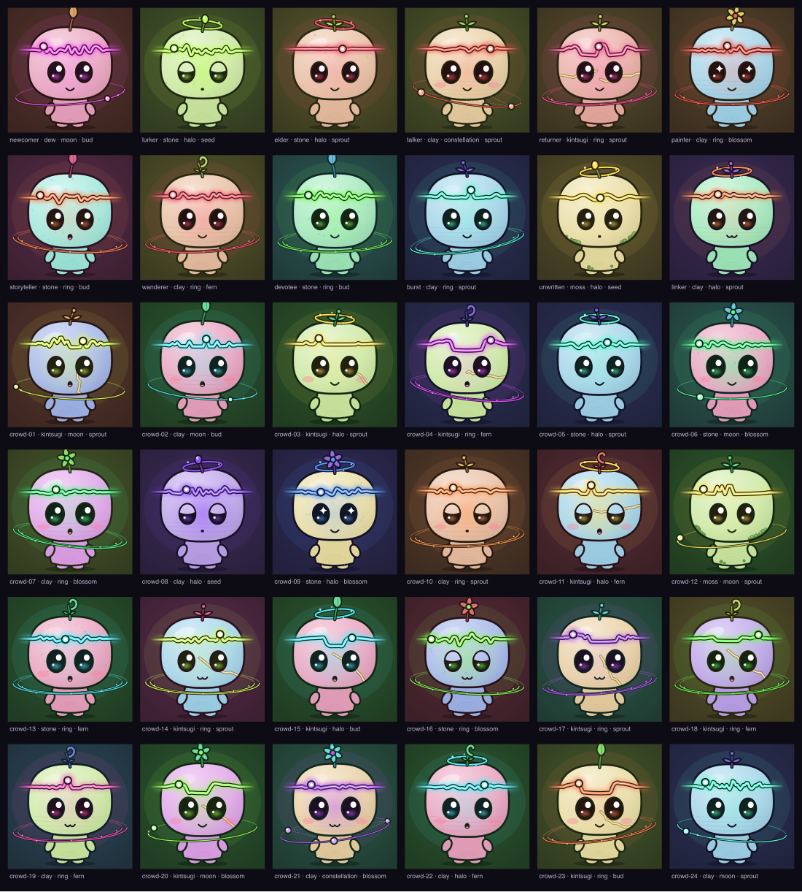

# Fatliners

777 beings, drawn from the Farcaster histories of the people who mint them. The first inhabitants of Fatline.



*36 beings from synthetic histories, not real people. Each caption: profile · material · orbit · bloom.*

- **The species:** [docs/SPECIES.md](docs/SPECIES.md): anatomy, the three directions we weighed, why the pebble won, sizes, and the living layer.
- **History → art:** [docs/DNA-MAPPING.md](docs/DNA-MAPPING.md): every rule, the indexer fields it needs, fairness tests, and what still needs calibration.
- **Atlas and minting:** [docs/ATLAS-AND-MINTING.md](docs/ATLAS-AND-MINTING.md): the Memory Atlas, the snapshot commitment, the contract (not deployed), and the owner's open decisions.
- **Coordination:** [docs/COORDINATION.md](docs/COORDINATION.md): what was agreed with the other sessions, and the remaining dependencies.

**Building the generator?** Start with [GENERATOR.md](GENERATOR.md): what we send you per account, and what you send back.

## Run it

Needs Node ≥ 22.12. No npm install: there are no dependencies.

```sh
cd fatliners

npm run preview            # → http://127.0.0.1:7777
npm test                   # 14 tests: determinism, goldens, fairness, privacy, archive reader, 32/128/1024 px
npm run sheet              # out/: 36 SVGs + Atlases, PNGs at 32/128/1024, contact sheet, 32 px icon strip

# a real FID from the local Fatline archive (read-only); --registered-at = onchain ID_REGISTER time in ms
npm run atlas -- --fid 18350 --registered-at 1699388175000 --snapshot-at 1792627200000

node bin/cross-engine.mjs  # with the preview running: Chrome and Node render all 36 byte-for-byte alike

cd contracts && forge test # 10 tests for the (undeployed) contract
```

PNGs need `rsvg-convert` (`brew install librsvg`); without it you get SVG only. The contract tests use `forge-std` from `../smart-contracts/lib`.

**In the preview:**
- Pick a synthetic profile, or load a real FID.
- See its five dimensions with exact numbers (the owner view), the public Memory Atlas, and the DNA.
- See it at 32 / 64 / 128 / 256 px.
- Toggle the living layer and the per-network signal arcs.
- "Regenerate from scratch" rebuilds from the raw history and compares bytes.

## Layout

```
src/hash.mjs, canonical.mjs, prng.mjs   sha256 (pure JS), canonical JSON, seeded streams
src/history.mjs                          snapshot format, validation, provenance, commitment
src/features.mjs                         history → five dimensions
src/dna.mjs                              five dimensions → visual DNA (the rulebook)
src/render.mjs                           DNA → SVG (full / icon / living)
src/atlas.mjs                            Memory Atlas (public / owner)
src/index.mjs                            generate(history)
src/sources/archive.mjs                  read-only reader for the Fatline archive (SQLite)
src/sources/synthetic.mjs                labelled synthetic profiles
bin/                                     preview server, sheet, atlas, cross-engine check
preview/                                 the preview page (runs src/ in the browser)
contracts/                               Fatliners.sol + Foundry tests (not deployed)
```

## What works, what is mocked, what isn't built

**Works (tested):**
- Deterministic generation, byte-identical across runs and between Node and Chrome. Golden hashes pin `render/1` + `dna/1`.
- 36 distinct beings from synthetic histories, readable at 32, 128 and 1024 px.
- Fairness: drawn detail doesn't correlate with volume (r ≈ 0.00), and a 10× quieter copy of a person keeps their traits.
- The public Atlas leaks no hashes, text, channels or partner FIDs.
- The read-only archive reader, against the real local archive: FID 18350, Farcaster, 320 merged messages.
- Contract logic: 777 cap, one per FID forever, origin survives transfers, signatures bound to minter and commitment, no payments.

**Mocked / synthetic:**
- Every being in the contact sheet. Their histories are invented and labelled `synthetic`. They're not FIDs.
- Registration time is passed by hand (`--registered-at`). The archive doesn't store it yet.
- Hypersnap provenance is tested with synthetic messages only. The archive has no Hypersnap rows yet.

**Not built:**
- The attester service.
- Deployment or any onchain action (needs the owner's yes).
- Art storage (IPFS or onchain).
- Threshold calibration on real FIDs.
- Keeping minted snapshots' hash lists after pruning.
- Integration into the Fatline client (`apps/` belongs to other sessions).
- A living layer driven by fresh history.

**Known caveats:**
- FID 18350 comes out as *kintsugi* (gold seams for "returns"). Its gaps may partly come from deleted casts (4,492 deletes), which we exclude, and from node pruning. A deleted cast leaves a silence. Is that the honest reading? It's an owner decision.
- *Ring* orbits are over-represented in the synthetic set (16/36), because the synthetic generator picks reply partners uniformly. This will be calibrated on real data.
