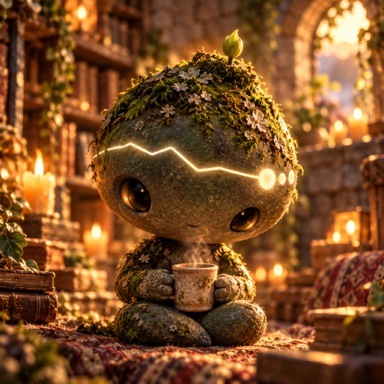
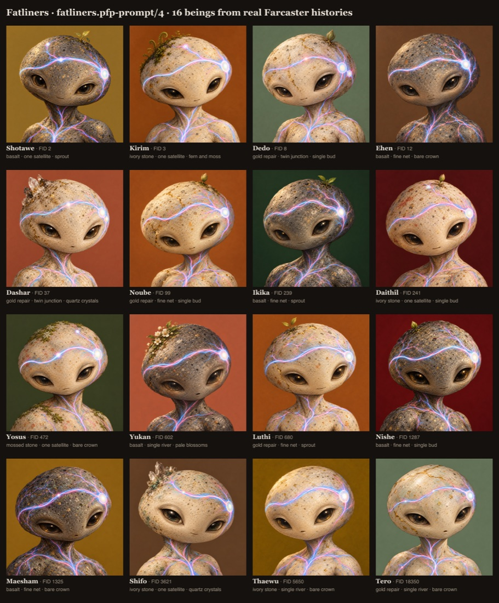

# Fatliner PFPs: from any FID to a reference-conditioned portrait

## Status, 2026-10-23: the figurine look (prompt v7, traits v7). Works; not yet run at scale

| | | | | |
|---|---|---|---|---|
|  |  |  |  |  |
| Tero · 18350 · gold-mended · storyteller | Kirim · 3 · basalt · storyteller | Shouvi · 299673 · moss · regular | Edis · 509202 · moss · maker | Somaeben · 1721477 · marble · linker |

`fatline fatliners prompt --fid <n>[,<n>…] --generate` makes these today, for any FID. The sections further down describe the earlier painted-bust versions (v4); the pipeline around them is unchanged.

**How we got here (the owner's feedback, round by round):**
- v4 painted busts: "they all look so much the same" → v5: bolder traits, recalibrated on 39 real top-777 accounts (`calibration/pfp-5.json`, now the default).
- v5: "no organic feel", and the blue/pink "should be an emergent property, like life force or electricity that runs as they do the work of sustaining the network" → v6: the being at rest, unlit veins, living skin. Network colours moved to `traits.network.live`, for a future live-node layer. Canon amended (SPECIES-CANON.md §3).
- v6: "not playful enough … they are like weird". Four cartoon styles (toy, retro, anime, sticker) were also rejected. The owner pointed at their own image "Sunset Gathering in the Cloud Ruins" → v7.

**v7, what changed:**
- Reference image 1 is the owner's image, `assets/FATLINERS_STYLE_REFERENCE.png` (`style-cloud-ruins/1`), used for style. `PROMPT_REFERENCE` in `src/pfp/pipeline.mjs` picks it for prompt v7. The species blueprint is no longer attached: it pulled every image back to one solemn face.
- The prompt (`prompts/pfp-7.prompt.md`) is short and leads with the look: a tiny collectible figurine with a huge round head on a small soft body, a calm sweet face, golden-hour tilt-shift miniature photography.
- `traits.figurine` says the same dimensions in that language:

| Shown | From the history |
|---|---|
| Material | Roots: age, continuity, comebacks (opal = under 120 days, gold seams = came back after a long gap, moss = on-and-off, basalt = old and steady, marble = young) |
| Eyes + **prop** | Voice temperament: listener (headphones), maker (paintbrush, easel), storyteller (book), linker (laptop), balanced (mug), no messages (unlit lantern) |
| Forehead line shape | Pulse: burstiness (calm arc / S-wave / zigzag) |
| Crown lights | Orbit: reply share and close bonds |
| Crown growth | Bloom: making, linking, rootedness, evenness |
| Pose, setting, head shape, temple side | Seeded: no meaning, only keeps similar histories apart |

  Every reading is relative to the top 777 (the calibration), never an absolute scale. The forehead line glows pale white; blue and pink are never painted in.

**Before running all 777 (open issues):**
1. **Disk.** Each being's folder keeps `history.private.json`, up to ~40 MB for big accounts (FID 3: 38 MB). For 777 that's several GB; the Mac had ~6 GB free and filled up once during this work. Compress it or keep only the commitment before a full run.
2. **ChatGPT limits.** Images go through Codex on the owner's ChatGPT account. Never tested beyond ~10 in a row. A run resumes (finished beings are skipped).
3. **Time.** ~70–110 s per image with `--jobs 3`: about 6–8 hours for 777, plus reading the largest histories.
4. **No review step.** The first image per being is kept; a bad one must be spotted and redone with `--revise`.
5. **Variety.** In the 5 samples, 3 of 5 have daisies and most settings are sunsets (the style image pulls toward golden hour). Settings and blooms could use more spread.
6. **Canon.** SPECIES-CANON.md §6 (Forbidden) rules out "large hats, crowns" and "external accessories used as a substitute for genuine variation", and also "ranking appearance quality by followers, wealth, or influence". The v7 props (small, and each one reads from the history) and any hats or a crown for top ranks need the owner's decision and a canon amendment. The style change itself (figurines instead of painted busts) should also be written into the canon.

Suggested next step: fix (1), then a ~30-being test batch from the top 777 to check (2) and (5).

---



*16 well-known accounts, read from our two nodes, traits `pfp-traits/4`, prompt `pfp-4`, made with Codex's image tool. Each caption: name · FID · roots · orbit · bloom.*

```
FID ─▶ our nodes (Snapchain + Hypersnap) ─▶ history ─▶ features ─▶ DNA ─▶ PFP traits ─▶ prompt ─┬▶ request (ready)
        src/sources/node.mjs                 history.mjs features.mjs dna.mjs pfp/traits.mjs pfp/prompt.mjs │
                                                                                                       └▶ + reference PNG ─▶ gpt-image-2 ─▶ portrait.png
```

This path sits **beside** the deterministic SVG generator. It reuses the same history, features, commitment, seed and DNA, and never changes them. The SVG renderer and `generate(history)` are untouched.

## Commands

```sh
fatline fatliners prompt --fid 18350                  # read our nodes, write traits + prompt + request. No image call.
fatline fatliners prompt --fid 2,3,5650 --generate    # also make the images (see "Image generation")
fatline fatliners prompt --fid 12345 --reference fatliners/assets/FATLINERS_MASTER_REFERENCE.png
fatline fatliners export --fid 18350 > 18350.input.json   # text-free input, for someone without node access
fatline fatliners prompt --input 18350.input.json     # compile offline from that file
node fatliners/bin/pfp-sheet.mjs                        # contact sheet of every accepted portrait
cd fatliners && npm run preview                         # → http://127.0.0.1:7777/pfp
```

Options: `--offline` (local archive only), `--only farcaster|hypersnap` (one network, labelled as such), `--prompt-version`, `--revise`, `--jobs n`, `--snapshot-at ms`.

Any positive FID works. Nothing checks rank, tier, mint eligibility, coins or a personal node. Generating a preview never mints or uses up a slot.

## Where the history comes from

1. The local Fatline archive (`.fatline/indexer.sqlite`), read-only, through `src/sources/archive.mjs`.
2. If a network's backfill for that FID isn't done, the **existing indexer adapter** (`indexer/src/adapters/snapchain.mjs`) copies it from that network's one pinned node, page by page. Progress is saved in `fl_backfill`, so a cut run resumes. 3 tries per network, 60 s per page.
3. The FID is **not** added to the indexer's follow list (`fl_fids`).

The commitment covers the message set per network, so a being's seed (name, pose, background) depends on which networks were read. A run with one node down gives a different, labelled single-network being, not a silent stand-in.

Pinned sources: per network, the first `own: true` non-localhost node in `fatline.config.json` (today: the Fatline master for Snapchain, the Fatline Hypersnap server). There is no fallback to hosted nodes. If one network fails, the result says so and is single-network. Node URLs never reach an output file, only their labels.

States are kept apart: `account-not-found` (no ID_REGISTER on our node), `unavailable` (no node answered), `untracked` (`--offline` and never backfilled), `known-no-messages` (the account exists and holds nothing).

Cutoff: by default the collection snapshot, **2026-10-22 00:00 UTC** (`COLLECTION_SNAPSHOT_AT`). The commitment, and so the seed, name and pose, depend on it. A moving "now" would give a new being on every run.

Age: ID_REGISTER on OP mainnet. FIDs from before the November 2023 migration show the migration date, so we take the earlier of that and the oldest message we hold. It may still be a lower bound (Snapchain prunes; FID 3's oldest message on both of our nodes is 2022-11-28).

## The species (from inspecting `FATLINERS_MASTER_REFERENCE.png`)

The reference is a 1536×1024 Renaissance-style blueprint sheet (sha256 `354bee98…71ce56`, version `species-blueprint/1`). What it fixes:

- **Head:** oversized, rounded pebble, widest at the upper cheeks, small chin. Pale ivory porous stone with dark pits and flecks.
- **Face:** large, deep, dark reflective almond eyes with heavy soft lids. Almost no nose. A tiny mouth.
- **Body:** small, compact, soft-bellied, short limbs, three-toed feet. A short neck.
- **The signature:** one serpentine light path across the forehead, ending in a bright round **temple node**.
- **Life-force:** fine branching lines under the skin, through the neck, shoulders, chest, spine and limbs. On the sheet they're drawn blue and pink, thin and soft, like veins seen through stone.
- **Colours:** a legend says **Snapchain = blue, Hypersnap = pink**. A branch-junction detail shows both meeting.
- **Permitted variations (bottom row):** Roots (ivory stone, basalt, mossed, gold repair, opal/translucent); Orbit (path topologies with extra nodes); Voice (three eye/lid expressions); Pulse (branch rhythms down the arm/back); Bloom (moss and sprouts, small flowers, crystals).
- **Not part of a PFP:** the parchment, title, labels, construction circles, the three views and the swatches.

## History → visual traits (`fatliners.pfp-traits/4`)

The PFP traits read the same features, seed and DNA as the SVG generator and never change them. The DNA's legacy forms are recorded in each trait's evidence.

**Why calibrated.** The DNA's thresholds were set by eye on synthetic histories. On real well-known accounts, nearly every one landed on the same side: reply share 0.63–0.89 (so "wide" eyes for all), reply spread 0.82–0.97 (so "ring" orbit for all), and the circle and channel counts hit their caps. The first real batch looked like one being, 16 times. So each ratio is now placed against the **quantiles of real accounts** (`calibration/pfp-3.json`, made by `bin/pfp-calibrate.mjs`):

- Sample: the 15 well-known FIDs used here, plus 60 FIDs drawn by a seeded PRNG from 1–20,000. Kept if ≥ 500 posts + reactions: 33 accounts.
- **A proxy.** Once `ranking.tsv` exists, recalibrate on the real top 777 (a new calibration name, which gives a new cache key).
- Only quantiles of ratios are stored. The calibration's hash is in every cache key and manifest.

"low / mid / high" below = below the 33rd percentile / between / above the 67th. "top 20%" = at or above the 80th.

| Dimension | Evidence → form | PFP expression |
| --- | --- | --- |
| Roots | age < 120 d → opal; ≥ 1 return (silence ≥ 90 d and ≥ 6× own median gap) → gold repair (1–3 seams); continuity low → mossed; age ≥ 67th pct and continuity ≥ median → basalt; else ivory | the five substrates of the sheet |
| | age against the 20/50/67/80th percentiles | patina 1–5 |
| | DNA glaze (seed only) | a muted undertone. Never blue or pink |
| Orbit | reply share low → single river; mid → one satellite, or twin junction if replies concentrate on a few people (bonds ≥ 67th); high → fine net, or constellation if concentrated | path topology and extra nodes on the head |
| Voice | temperament = the ratio furthest into its own top 20%: listening → listener, media → visual, text length or long casts → storyteller, links → linker; none → balanced | eyes: soft-lidded, starlit, long, alert; balanced → wide (reply share high) or full. **Always almond** |
| | the temperament also sets the mouth and the accent (silver, gold, amber, verdigris) | the irises stay dark; the accent is only in flecks and the eye highlight |
| | text length low/mid/high/top 20% → matte/satin/gloss/pearl; listening ≥ 67th → inner glow; mentions in the top 20% → cheek flush | finish and small details |
| Pulse | burstiness low/mid/high → steady/flowing/bursts; active-week share → glow strength; the brightest bead sits at the activity peak | rhythm of the paths |
| Bloom | media in the top 20% → pale blossoms; links in the top 20% → quartz crystals; rarely in channels (< 20th) → bare crown; channels even (≥ 67th) → fern and moss; uneven (< 33rd) → single bud; else sprout | growth on the crown (never pink) |

Seeded only (to tell similar histories apart): head shape, pose, temple side, background colour (9 muted flat colours, no blue or pink, no charcoal behind basalt), undertone, name. FID digits never mean anything.

**Fairness:** only ratios are binned, never volumes, and every form is one short instruction of similar visual weight. A 300-message account and a 100,000-message account draw from the same lists (FID 18350 with 313 posts and reactions: gold repair, single river, long eyes, bursts).

**Coverage rules:**
- Fewer than 30 posts + reactions = sparse: the readings are noise, so roots go ivory, temperament balanced, pulse flowing, and orbit and bloom are picked by the seed (labelled `seeded`). The prompt says so.
- No messages = an "unwritten" being: faint paths, neutral, equally finished.
- Gaps are "unknown, not absence" in every prompt. We never infer hardship, abandonment or psychology.

## Networks: observed, not operated

Each message carries the networks that hold it. We count **shared** (on both), **Snapchain only** and **Hypersnap only**. Shared fork history is counted once, as shared, never as two engagements.

- Both read, < 2% exclusive → a braid of blue and pink in equal measure.
- Both read, some exclusive on both sides → braided, plus single-colour tips.
- Mostly exclusive to one → braided, that network's colour leads.
- One network read → only its colour, and the prompt says the other wasn't read (no negative claim).

`nodeOperation` is always `unverified`: holding history on a network isn't proof of running its node. Every account measured so far (FIDs 2, 3, 8, 12, 37, 99, 241, 472, 602, 680, 1287, 1325, 3621, 5650, 18350) has an identical message set on both of our nodes, so all are braided. Only exclusive activity would change that.

## The prompt

`fatliners/prompts/pfp-<n>.prompt.md`. The compiler (`src/pfp/prompt.mjs`, pure) takes the body between `FATLINER_PFP_PROMPT_BEGIN` and `…_END`, fills the slots from the traits, rejects unknown slots, empty directives, `{{`/`<!--`/control characters, and anything left unresolved. An empty honor slot is removed cleanly.

- `pfp-1`: the owner's wording, unchanged.
- `pfp-2`: + one collection style (hand-painted, not CGI), fixed framing, soft thin light, dark irises, a flat background colour.
- `pfp-3`: + one fixed light for the collection, hairline paths and a clear face, near-black irises, muted backgrounds.
- `pfp-4`: + the mouth is a seam (no lips), irises dark as wet basalt, the eye expression readable at avatar size. **Current.**

No raw text, URLs, channels, hashes or counterparties reach the prompt (tested).

## Outputs

`fatliners/out/pfp/fid-<N>/<key>/` (gitignored), with `key = hash(fid, commitment, traits version, calibration hash, prompt version, reference sha256)`. Change any of them and you get a new directory.

| File | Public? | What |
| --- | --- | --- |
| `pfp.prompt.txt` | yes | the full prompt. **Use it with the reference image attached.** |
| `pfp.request.json` | yes | our provider-neutral manifest: `gpt-image-2`, prompt hash, reference path/hash/size/version, commitment, versions, output size. **Not** OpenAI's HTTP schema. `status: ready` only with a verified reference |
| `traits.json` | yes | every visual choice with its evidence or "seeded", plus NFT attributes |
| `blueprint.json` | yes | name, seed, commitment, identity, directions |
| `provenance.private.json` | no | coverage per network, watermarks, counts, roots, caveats (labels only, no URLs) |
| `history.private.json` | no | the text-free snapshot used (message hashes) |
| `portrait.png`, `portrait.original.png`, `generation.json`, `metadata.json` | after generation | the accepted image (1024², and the model's original), what made it, and NFT metadata |

## A stable prompt, an accepted image

The prompt is deterministic: same history, cutoff, versions and reference, same bytes. The image is not: image models don't give the same pixels twice. So the first image made for a key is **accepted** and kept: running again returns it, and `--revise` writes `revisions/<n>/` beside it without touching it. A new reference, prompt or trait version gives a new key, never an overwrite.

`metadata.json` has `name`, `description`, `image`, `attributes`, and a `fatliner` block (FID, commitment, versions, prompt and reference hashes, generation, image hash). No `animation_url`. A portrait is not proof of minting, funding, uptime or node operation.

## Image generation

`--generate` uses the Codex CLI's built-in image tool (`src/pfp/codex-image.mjs`), which runs on the owner's ChatGPT login, so there's no API key. It attaches the reference as an image input (`codex exec -i reference-1.png`), passes the prompt verbatim inside a short wrapper, checks the result is a PNG, and saves it.

- Codex's own imagegen skill names this tool as gpt-image-2, but the tool doesn't report the model per call. `generation.json` says exactly that.
- About 2 minutes per image. `--jobs 3` runs three at once.
- Using the OpenAI API directly instead (with a key) would be a second adapter behind the same `pfp.request.json`. Not built.
