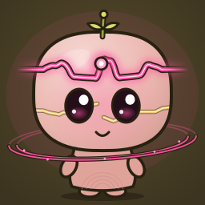
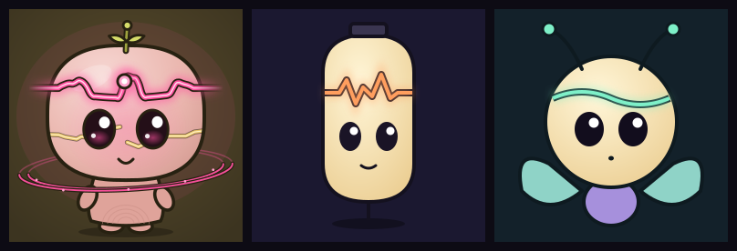

# The Fatliners: species guide

> **Superseded for the look and the rules:** [SPECIES-CANON.md](../SPECIES-CANON.md) (v1.0, 2026-10-23) and its blueprint `assets/FATLINERS_MASTER_REFERENCE.png` are the authority now: a mineral being with a full small body, not the flat pebble below. This page stays as the history of the first direction.

777 beings. 777 histories. One species.

## Who they are

A Fatliner is a signal that has been carried long enough to remember who carried it.

Every message a person sends leaves a trace on the network. Most traces fade. Some keep each other company, and a few gather into a shape. A Fatliner is that shape: a small, soft creature with a line of light across its forehead. The line is the trace. It rises where its person was loud, and it lies flat where they were quiet.

Fatliners don't judge the line. A flat stretch is a rest, not a failure. The first 777 were born from the first 777 people who asked for one.

(Our own lore. Fatline takes its name from a novel; nothing here borrows its text or its names.)

## The anatomy (fixed for all 777)

| Part | Rule | Why |
| --- | --- | --- |
| **Head** | A soft superellipse "pebble", about 2/3 of the tile, flatter at the chin. | The silhouette is the collection. A pebble is easy to draw and reads at 32 px. |
| **Signal line** | Crosses the forehead and **runs out past both sides of the head**, fading into the air. | This is the mark of the species. No other PFP is a blob pierced by a light. |
| **Node** | A bright bead on the line. | It sits at the moment of the person's history with the most activity. |
| **Eyes** | Two large dark ovals with two white catchlights, the iris faintly lit in the signal's colour. | Emotion is in the eyes. The second catchlight sits low, which keeps them soft. |
| **Body** | A small bell, two arm nubs, two feet, and a shadow. | Small body, big head: young, harmless, curious. |
| **Ink** | One dark outline around everything, about 3.6/256 wide (6.5 in icon mode). | It holds the shape together at any size and on any background. |
| **Background** | A dark, lightly tinted square with a soft glow behind the head. | The line glows on dark. 777 dark squares together read as one night sky. |

**Drawing one from memory:** a rounded square head on a little bell body. Two big dark eyes with white dots. A glowing wavy line across the forehead, poking out on both sides, with a dot on it. That's a Fatliner.

## What varies (the visual grammar)

Each trait is chosen from a short list of forms. Every form costs about the same amount of drawing, so no history earns a "fancier" being. See [DNA-MAPPING.md](DNA-MAPPING.md) for the rules.

| Dimension | Where it shows | Forms |
| --- | --- | --- |
| Roots (time) | skin material, growth rings on the belly | dew, clay, stone, moss, kintsugi (gold seams, one per return) |
| Orbit (others) | a ring around the shoulders, or a halo | halo, moon, binary, constellation, ring |
| Voice (expression) | colour harmony, translucency, finish, eyes, mouth, blush | 5 harmonies × 4 finishes × 4 eye forms × 4 mouths |
| Pulse (rhythm) | **the line's waveform**, the node's position, glow strength | wave, spike, steady, plus the curve itself (48 points) |
| Bloom (cultivation) | the sprout on top of the head | seed, bud, sprout, fern, blossom |
| Seed only | skin glaze (12 hues), tiny shape jitter, satellite and seam placement | |

The waveform alone has effectively unlimited variety, because it's the person's real history. Two beings with the same trait list still have different lines.

## Three directions we considered

| | A. Pebble (chosen) | B. Lantern | C. Moth |
| --- | --- | --- | --- |
| Idea | A soft creature with the signal across its forehead, poking out past the head. | A glass lantern; the signal is its filament. | A round head with antennae; the line joins them. |
| Recognizable at 32 px | **Yes.** Pale blob, bright horizontal line, two dark eyes. | Partly. A capsule shape is generic (battery, pill). | Partly. Antennae and wings disappear at 32 px. |
| Expressive | **High.** Big eyes, mouth, blush, lids. | Low. A lantern has no body language. | Medium. Good eyes, but wings dominate. |
| Simple to draw | **Yes.** A child can draw it. | Yes. | No. Wings and antennae are fiddly. |
| Room for history | **High.** Material, orbit, bloom, line: each has its own place, nothing overlaps the face. | Low. Little surface besides the glass. | Medium. Wings carry pattern, but then the wings become the collection. |
| Risk | Close to "cute blob" PFPs; the line, its tails and the node are what make it ours. | Reads as an object, not a being. | Reads as a bug or fairy, which is another species. |

**Why A:** the brief asks for a being, readable at 32 px, that a child could draw from memory, with a luminous line as the defining feature. Only A puts the line in the strongest position (across the face, breaking the silhouette) and keeps a face with full expression. B and C were drawn as one-off sketches; only A has a renderer.

## Size behaviour

- **1024 px and 256 px:** full detail: textures, growth rings, glints, dust, thin orbit backs.
- **128 px:** the same SVG; fine detail fades naturally.
- **32 px:** `renderSvg(dna, { detail: 'icon' })` draws a simplified version, like font hinting. Heavier ink, a thicker line with fewer points, bigger satellites, no texture. The silhouette, line, node and eyes all survive. Check: `out/icons-32.png` after `npm run sheet`.

## Living representation

`renderSvg(dna, { living: true, signal: { farcaster: 'synced', hypersnap: 'behind' } })` adds:
- blinking, about every 5 s (turned off when the viewer prefers reduced motion)
- a spark running along the line
- a gentle bob of the orbit
- one arc around the node per network the being is seen on: violet for Farcaster, mint for Hypersnap, dashed while that network's node is behind

The permanent face stays exactly the same underneath. Only the living layer changes.

See `img/living-returner.svg` (open it in a browser).
