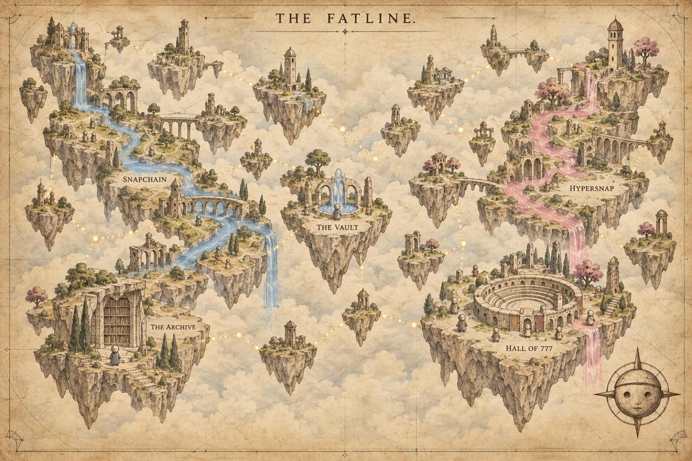

# The world of the Fatliners

The Fatliners live in the spaces between transmissions: old stone ruins floating above a sea of clouds. These nine scenes show how their lives and the network are one thing. The lore comes from [SPECIES-CANON.md](../SPECIES-CANON.md) (§1, §7, §8, §10); each scene's caption says which real part of Fatline it stands for.


**The Weaving.** Every Fatliner, just by living, spins a thread. Where the threads meet, there is a network.
*In Fatline:* each node that runs is one more full copy of Farcaster kept by someone who isn't a company. The network is the sum of the copies.

| | |
|---|---|
|  |  |
| **You Are Your FID.** One cast, one more stitch. The being is drawn from its history, and its history is what feeds the line. *In Fatline:* the five dimensions (Roots, Orbit, Voice, Pulse, Bloom) are read from the account's own messages on our nodes. | **Two Currents.** Snapchain runs blue, Hypersnap runs pink. A Fatliner can hold both without mixing them up. *In Fatline:* both networks are equals; the archive keeps what each one says, side by side. |
|  |  |
| **The Vault.** People feed the vault; the vault feeds the node. Fed, it lives. Empty, it goes dark, and everyone can see it. *In Fatline:* trading fees in USDC go to the vault, which pays the server. | **The Sleeper.** A being can sleep. Dormancy is not death: anyone who feeds the vault brings it back. *In Fatline:* nobody pays for the time a node was dead; a deposit revives it. |
|  |  |
| **The Archive.** Their bodies are memory. They keep what was said, on each network, and never erase a difference. *In Fatline:* `fl_messages` keeps one row per network per message. | **The Hall of 777.** Day one, the first 777 take their seats. Then 7,777. Then 77,777. Then everyone. *In Fatline:* the minting tiers, from the ranking computed on our two nodes. |


**A Node Is Born.** Its coin's fees fill the basin. When there is enough to pay for a node, the tower lights up and the Fatliner has a body. *In Fatline:* "alive" means trading fees cover the node (the owner's rule, 2026-10-22). Not built as an onchain rule yet.



**Map of the Fatline.** The world, as the keepers drew it.

---

And the question stays open, as the canon asks: *did the network create the Fatliners, or did the Fatliners teach the network how to connect?*

## How these were made

```sh
node fatliners/bin/world.mjs            # every scene in scenes.json without an image yet
node fatliners/bin/world.mjs --redo the-vault
node fatliners/bin/world.mjs --dry-run  # print the prompts
```

- Model: `gpt-image-2.5-sunburst`, through the [Bankr LLM gateway](https://docs.bankr.bot/llm-gateway/image-generation) (`llm.bankr.bot`), 2026-10-23. Key from `BANKR_API_KEY` or `~/.fatline-bankr-key`.
- The gateway is text to image only (no reference image), so the look of the portraits (`assets/FATLINERS_STYLE_REFERENCE.png`) is described in words in `scenes.json` → `style`.
- About 12,000 output tokens for all nine, roughly $0.40 at Bankr's listed price. Each image's prompt, model and token count are in `img/<slug>.json`.
- Not deterministic: running a scene again gives a different picture. The portraits of the 777 are a separate pipeline ([docs/PFP.md](../docs/PFP.md)).
- The JPGs here are 1600 px; the full-size PNGs stay on the machine that made them.
