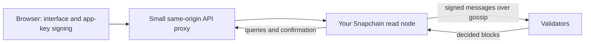

# Farcaster, October 18, 2026

**Recommendation:** build an understandable, independently runnable Farcaster starter client; teach it in Spanish; package its verified setup and customization workflow as a portable agent skill. These should be three ways to use the same implementation.

The long-term idea is a workshop for creating personal clients. The first deliverable should be one complete, inspectable example that another human can successfully operate. A broad client generator before that would multiply untested assumptions.

This recommendation draws on the preferences expressed in this conversation: you are a long-time Farcaster builder, a self-taught programmer, interested in teaching, Spanish-language video, and agents that help people build their own software. I do not have an independent archive of our previous work available here, so I am not assuming other projects or preferences.

## What I actually checked

Using the supplied Neynar credential, I retrieved the latest 150 casts for FID 37, including replies. They span August 16, 2024 through October 18, 2026. This is a recent-history sample, not his complete lifetime history or a representative sample of the entire network. I also fetched the bounty conversation with reply depth two and a limit of 50, and read the four references Balaji supplied, current Snapchain documentation, selected implementation files, and published SDK declarations.

The extracted casts are in [balaji-casts.ndjson](balaji-casts.ndjson). The full API responses and downloaded upstream sources are retained locally and excluded from Git. The API key was used in request headers and is absent from these files.

The reference source commit is `fc87f2686472598143062a00e1c2b2633b2d87ab`. GitHub reports [Snapchain v0.14.3](https://github.com/farcasterxyz/snapchain/releases/tag/v0.14.3), published October 15, as the latest release at retrieval time. The relevant published packages were `@farcaster/core@0.20.0`, `@farcaster/hub-nodejs@0.17.0`, and `@farcaster/hub-web@0.13.0`. I inspected declarations and re-exports, not a running application.

## The bounty has already changed in two important ways

The [original bounty](https://farcaster.xyz/balajis.eth/0x50184b62b4c52fd76628713562e1eda3dccaf63d) was posted **October 17, 2026, 14:47:30 UTC**. Its stated seven-day deadline is **October 24, 2026, 14:47:30 UTC**, or **11:47:30 in America/Santiago**. This is calculated from the API timestamp and the wording of the post; it is not a separate deadline confirmation from the organizer.

On October 17 at 18:14:10 UTC, Balaji posted a [clarification](https://farcaster.xyz/balajis.eth/0x0a05d5c832726585c97313b7745319b4ed1d25ce):

| Original wording | Current clarification | Consequence for us |
| --- | --- | --- |
| Read nodes do not accept writes | They accept message submissions and relay them to validators | Our own node can serve as the client's read and submission endpoint |
| An app key needs a small Optimism transaction | Gasless app keys are available | Use custody-authorized `KEY_ADD` rather than requiring gas for a new signer |
| Import an existing seed phrase | This is a developer exercise; use a test account and prefer delegated authorization where possible | Provide the requested educational import path without normalizing primary-account seed entry |

These corrections are supported by the [node-role documentation](https://snapchain.farcaster.xyz/node-types), [writing guide](https://snapchain.farcaster.xyz/guides/writing-messages), and documentation PRs [1034](https://github.com/farcasterxyz/snapchain/pull/1034) and [989](https://github.com/farcasterxyz/snapchain/pull/989). They are not merely interpretations of the original post.

The deliverable still needs three setup commands, a mobile- and desktop-friendly microsite, MIT-licensed original code in a public repository, a real person who successfully creates a node and client, and that person's public endorsement. The entry is a reply with the microsite, repository, and endorsement URLs. A skill by itself does not satisfy those requirements. Human testing is part of the deliverable, not promotion to do afterward.

## What is happening socially

On October 15, Balaji [announced that Network School is acquiring Farcaster](https://farcaster.xyz/balajis.eth/0x83c734e1985ad2b6f28bea2938a750981740a093). He described a reference-client direction centered on learning, earning, community, an explicit moderation policy, an onchain vote, and a written social contract. This is his announced direction, not independent evidence that every acquisition step or proposed feature is complete. I have not audited the vote, electorate, or reported support percentages.

His [October 17 prize announcement](https://farcaster.xyz/balajis.eth/0xf454b8d3e5ee2c9252a0b7574ad4942e9ba502d2) frames bounties as a way to fund useful public digital infrastructure and eventually attract digital employers. The client bounty fits that program: help people operate the protocol and prove that others can reproduce the work.

The older casts make the direction less surprising. In [February 2025](https://farcaster.xyz/balajis.eth/0x2c77a09b2cf680dfca633fe51c31845b0ccbf10f), he described Farcaster as infrastructure on which to prototype AI-enabled social experiences. In [June](https://farcaster.xyz/balajis.eth/0x28d54ea58cf15a07f9d31b0738981266fd621185), he emphasized its reusable social backend. In [July](https://farcaster.xyz/balajis.eth/0xfcfc074b6d176fe1d714e0f4837b948d48d69fa9), he compared the desired client diversity to software speaking HTTPS. His [August moderation proposal](https://farcaster.xyz/balajis.eth/0x7ba31ab5bda4a4f32884994308f237d3b8035b22) argued for strong defaults in the reference app alongside freedom to use other clients.

My interpretation: the current dispute over the reference client's direction makes practical client independence especially relevant. Our educational position can be constructive: make it easy to understand, verify, and exercise the choices the protocol allows. We do not need to adopt a faction's politics to demonstrate that capability.

The bounty replies already contain several builders attempting three-command deployments and seeking testers. This is evidence of active participation, not an exhaustive competitive survey or proof that those submissions work. Another scaffold alone will be hard to distinguish. Clear teaching, dependable recovery from setup errors, and successful independent users are stronger differentiators.

## The protocol model the tutorial should teach

| Concept | Meaning in this project |
| --- | --- |
| FID | A stable numeric account identifier. Balaji is 37. A username is a human-readable name associated with an account, not its durable identifier. |
| Custody address | The Ethereum address controlling the FID. It authorizes app keys and account-management actions. It is not necessarily the address holding a user's tokens. |
| App key / signer | An Ed25519 key authorized to sign social messages for an FID. A separate key per client limits what needs to be shared and revoked. |
| Message | A signed operation: cast, reaction, follow/unfollow, profile update, and so on. Ordinary social actions are not individual paid Ethereum transactions. |
| Snapchain | The ordered, replicated social-data network. Validators decide blocks; other nodes synchronize and serve the resulting state. |
| Read node | A node you operate to keep and query state, and relay submissions. Running one gives data access and operating responsibility; it does not give a vote in consensus. |
| Storage rent | Account-level capacity and retention rights. Separate from the disk and bandwidth bill for the server running your node. |
| Client | The interface and rules for presenting and interacting with shared protocol data. Feed ranking and local filtering are software we choose. |

The [architecture overview](https://docs.farcaster.xyz/learn/architecture/overview), [accounts material](https://docs.farcaster.xyz/learn/what-is-farcaster/accounts), and [Snapchain whitepaper](https://snapchain.farcaster.xyz/whitepaper) explain the core separation. Some surrounding prose still describes older Hub/CRDT behavior, so we should use the current implementation and release-specific guides for operational claims.

The [current validator documentation](https://github.com/farcasterxyz/snapchain/blob/fc87f2686472598143062a00e1c2b2633b2d87ab/site/docs/pages/validators.mdx) lists seven equally weighted validator keys: five Neynar, one Uno, and one Degen. Five signatures suffice for a commit. This is a documentation snapshot, not a live attestation of which operators were online at retrieval time. Read access is permissionless; validator membership is a separate, restricted set. A self-hosted node still depends on network consensus, peers, and bootstrap material.

There are two bills a beginner must understand: storage associated with their account, and compute associated with their node. Existing account storage does not pay for a server. Gasless app-key registration does not make account creation, storage renewal, or hosting free. The tutorial should query actual account capacity with [`storageLimitsByFid`](https://snapchain.farcaster.xyz/reference/httpapi/storagelimits), instead of repeating old fixed dollar prices or quotas.

## What a working client actually requires

The simplest architecture I recommend is:

The proxy would make mobile HTTPS access and browser networking straightforward. It should target the configured node, accept only intended request shapes, and never become an arbitrary URL proxy. The custody phrase stays in a local authorization tool; the normal app needs only its delegated signer. Browser-side key storage and mobile authorization remain implementation decisions to validate.

**Submission is not confirmation.** A read node validates a submission and relays it; it has no durable local mempool for those messages. Gossip can fail. The interface needs pending, confirmed, and failed states, and confirmation by retrieving the message or observing its merge event. Retries should reuse the already signed message rather than silently creating a second cast. This behavior is described in the [node-role guide](https://snapchain.farcaster.xyz/node-types#message-submission-and-the-mempool) and visible in the pinned [submission handler](https://github.com/farcasterxyz/snapchain/blob/fc87f2686472598143062a00e1c2b2633b2d87ab/src/network/server.rs) and [read-node relay](https://github.com/farcasterxyz/snapchain/blob/fc87f2686472598143062a00e1c2b2633b2d87ab/src/mempool/mempool.rs).

**The node does not deliver a finished home feed.** Its [casts API](https://snapchain.farcaster.xyz/reference/httpapi/casts) supplies primitives such as casts by FID. For the first client, obtain the user's follows, retrieve recent casts with pagination and bounded concurrency, merge them chronologically, deduplicate by hash, and cache the result. This is enough to teach and test. Broad search, large-scale ranking, and network-wide discovery eventually warrant a local index or a [Postgres replication pipeline](https://snapchain.farcaster.xyz/guides/syncing-to-db). They should not be mandatory infrastructure for the first hello world.

**Client filtering takes real attribution work.** A raw cast contains a signer public key, not Neynar's enriched `app` object. Resolve the signer for the author's FID and map it to the requesting app FID. Gasless signer records expose `requestFid`; older onchain signers require [decoding key-request metadata](https://docs.farcaster.xyz/developers/guides/advanced/decode-key-metadata). Cache this association. The pinned [HTTP implementation](https://github.com/farcasterxyz/snapchain/blob/fc87f2686472598143062a00e1c2b2633b2d87ab/src/network/http_server.rs) implements `/v1/signer` and `/v1/signersByFid` even though the HTTP onchain reference has not fully caught up.

Attribution authenticates the key requestor, not which executable or UI a person actually used. Keys can be reused; expired or revoked keys can be difficult to resolve retrospectively. Display an explicit unknown state and retain observed provenance locally. Excluding an app filters this client's display, not network data or other people's clients.

**Gasless authorization should be taught explicitly.** The new signer registration is a custody-authorized `KEY_ADD`. Its metadata also identifies the requesting app, and the new Ed25519 key signs the message envelope. Scope, expiration, and nonce rules are part of authorization. The published [writing guide](https://snapchain.farcaster.xyz/guides/writing-messages) is the starting point; the SDK's `makeKeyAddBody` and `makeKeyAdd` helpers are available in the inspected package declarations. Use the gasless helpers and EIP-712 domain, rather than mixing in the old onchain request-signature domain.

A personal developer exercise can use the same FID as account owner and requesting app. A distinct client identity needs its own requesting app FID and authorization. That choice affects include/exclude filtering: changing a client's name or CSS does not create a distinct protocol app identity. We must resolve the app identity and key-request signing arrangement before promising that every generated fork is independently identifiable.

Sign In with Farcaster proves login identity. It does not, by itself, grant a key permission to cast. The [AuthKit introduction](https://docs.farcaster.xyz/auth-kit) describes the authentication flow; posting authorization is a separate operation.

## Where the documentation is still rough

The roughness is a reason to build this project carefully, and useful material for an honest video:

- The [Snapchain getting-started page](https://snapchain.farcaster.xyz/getting-started) specifies 16 GB RAM, four CPU cores, and 2 TB free disk. The repository README still says 1.5 TB. Plan around the more conservative 2 TB requirement, then measure actual disk and snapshot behavior.
- The official AWS walkthrough contains an approximate monthly cost. It is not a provider quote for today's instance, 2 TB volume, and egress. Price the actual deployment before provisioning and document shutdown as well as setup.
- The bootstrap downloads a manager script, prompts for operator identity, fetches release files, and installs an upgrade schedule. Wrapping that in one shell line is not yet a deterministic unattended installer.
- The general hello-world guide still uses an onchain signer-registration path. The newer writing guide is more current, but also links an example repository that it says still uses the older path.
- The old messages guide describes Hub eventual consistency and fixed storage quotas. The current chain has versioned behavior; avoid copying those claims indiscriminately.
- The full source includes channel features that are gated on future activation. Source-code presence alone does not establish live mainnet support. Channels can wait for this first client.

The [official client source](https://github.com/farcasterxyz/client) is MIT-licensed and useful to inspect. Its README describes a generated snapshot of the web/mobile client, excludes the wallet implementation, and says it points to the production Farcaster API. Forking it does not automatically produce an independently backed client. I recommend a smaller implementation for teaching, while consulting that source for established interaction patterns.

Snapchain itself is GPL-3.0. Our original client, scripts, and tutorial can be MIT-licensed while using the official node as separate infrastructure. Do not copy upstream GPL implementation into the starter and relabel it MIT; preserve upstream licensing and notices where applicable. The locally cached upstream sources are deliberately excluded from the proposed public repository content.

## The product direction

I would describe Fatline as **a workshop for building your own Farcaster client**. Its first reference client should have a following feed, a composer, replies, follow/unfollow, like/unlike, visible app attribution, include/exclude filters, and a small connection-status panel. The panel should reveal the node endpoint, synchronization state, and the confirmation state of a submitted message. These are both useful features and teaching instruments.

Offer two learning paths over the same code:

1. **Build with me:** the video and written tutorial explain each layer, with checkpoints in the repository.
2. **Build with your agent:** a portable skill calls the same setup commands, inspects the same health checks, and customizes the same starter.

The skill's value is a verified procedure with recovery steps. It should detect stale node state, incompatible SDK versions, expired signers, missing scopes, wrong custody derivation, exhausted storage, and unconfirmed submissions. A long prompt saying “build a client” would leave agents to rediscover all those failure modes.

Make the first customization visibly change a user's experience: a Spanish interface, a feed limited to a chosen set of people, or exclusion of a selected app. Keep normal usage independent of an LLM. An agent helps create the software; users should still be able to run it after closing the agent harness.

The “client of clients” becomes credible when two forks can run against the same node, use the same social identity, present different feeds, and still communicate. That is a strong second demonstration after the basic client works.

## What to do before the deadline

Use October 18–19 for the difficult proof: provision one real machine, sync a real node, register a gasless key from a disposable existing account with storage, submit a message through that node, and read it back. Log versions, time, disk use, and failures. This de-risks the core promise before polishing a site.

Use October 20 for the minimal UI and signer-based app filtering. Use October 21 for a full three-command run on a fresh machine and a draft English/Spanish tutorial. Start independent testers by October 22, leaving October 23 for fixes and a real endorsement. Submit on October 24 with a margin before 14:47:30 UTC. This is a proposed schedule, not work already completed.

I would target three independent testers with different starting points, although one successful public voucher is the stated minimum. At least one should be a Spanish-speaking learner close to the video's target audience. Ask them to record where instructions fail, how long setup takes, and whether they can explain the custody/app-key distinction afterward. Do not prewrite their endorsement or imply their experience happened before it did.

Make the microsite and repository sufficient to qualify even if the full edited video takes longer. Record the real build now; publish the long-form video when it teaches well. The bounty funds the first tested path. The lasting work is giving people the knowledge and tools to build a second client of their own.

## Remaining uncertainty

No cloud machine was provisioned, node synchronized, account imported, signer registered, message posted, or human tester recruited during this research. No live validator quorum or cost estimate was verified. Provider choice, fully unattended bootstrap behavior, mobile signer handling, historical app attribution coverage, and multi-user app identity need practical validation. The extracted posts and source checks support a build direction, not a claim that the proposed commands already work.
